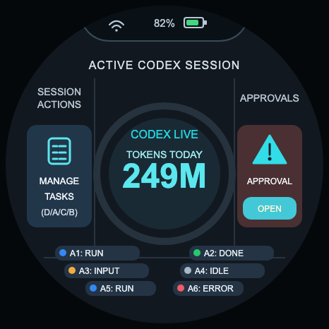
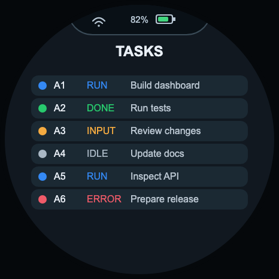
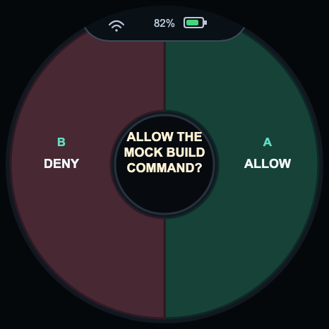
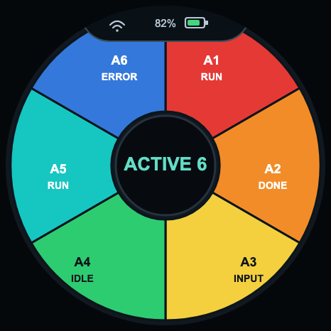
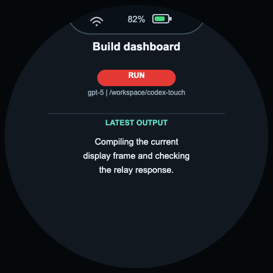

# Codex Touch

基于 Waveshare ESP32-S3-Touch-AMOLED-1.75C 的 Codex++ 中转看板。
Python relay 运行在 macOS 上，连接 Codex++ 的本地 CDP renderer，汇总 agent、approval、choice
和用量状态；开发板通过局域网 HTTP 读取脱敏状态并提交交互动作。当前项目的真实数据链路以
Codex++ 为唯一来源，面向使用中转代理的 Codex++ 工作流适配。

## 能力

- 圆形 466x466 看板：Home、Tasks、Approval、Agents，以及按需打开的 Agent Detail。
- 首页右滑或点击 Tasks 卡片进入 Tasks，Tasks 左滑返回首页；首页左滑或点击待处理 Approval 卡片进入 Approval，Approval 右滑返回首页。
- 首页上滑或点击底部 agent 状态条进入 Agents，Agents 下滑返回首页；电源键从任意页面返回 Home。
- 在 Agents 页面点击单个 agent 扇区，Agent Detail 从下方进入；详情页持续显示该 agent 的最新 Codex++ 输出，下滑返回 Agents。
- Approval 的同意/拒绝和 choice 的 A/B/C/D 选项可以从触摸屏提交。
- 所有数据轮询、Wi-Fi 重连和新 approval 到达都不会自动切页；页面仅由明确的触摸手势、点击或电源键切换。
- 顶部状态栏统一显示 Wi-Fi、居中的电量百分比和电池图标，状态栏变化使用局部刷新。
- 页面使用双 Sprite 和 ease-out 滑动动画，agents 扇区数量按真实 agent 数量动态绘制。
- relay 只在 macOS 保存 Codex 登录态，开发板不保存 `auth.json` 或 Codex access token。
- 可选 mock 模式，用于首次接线和屏幕验收。

真实数据链路以 Codex++ 为准：relay 通过 Codex++ 的本地 CDP renderer 读取
`__codexDailyTokenUsageV1` 当日用量账本，并通过 `~/.codex/sqlite` 和 rollout 文件读取任务、模型、provider、工作目录和 token 状态。
这条链路不依赖 OpenAI 官方 usage endpoint，也不把 Codex CLI app-server 作为默认数据源；
`--official-usage` 仅作为显式的可选兼容通道。

## Demo 展示

下面是当前 466x466 开发板 UI 的页面预览。截图由
[`demo/status-bar-demo.html`](demo/status-bar-demo.html) 导出，并与 [`src/main.cpp`](src/main.cpp)
中的当前布局和导航保持一致。demo 可通过底部按钮或触摸滑动切换；在 Agents 页面点击扇区即可进入详情，
详情页下滑返回 Agents。也可以用 `?view=tasks`、`?view=approval`、`?view=agents` 或
`?view=agent-detail` 直接打开指定页面。

更新界面后，用下列脚本重新生成 README 截图：

```sh
./scripts/capture_demo_screenshots.sh
```

该脚本使用本机的 Google Chrome 或 Chromium；其他位置可通过 `CHROME_BIN` 指定浏览器可执行文件。

### Home



### Tasks



### Approval



### Agents



### Agent Detail



Agent Detail 停留期间会持续刷新最新输出；真实 relay 从 Codex++ rollout 中读取当前 agent 的最新 assistant 输出。

[观看 Bilibili 开发板演示视频](https://b23.tv/h7US4gV)

## 从零开始：macOS

下面的流程适用于一台没有项目依赖的新 Mac。项目使用 PlatformIO 构建固件，
不要求 Arduino IDE；Arduino ESP32、M5Unified、M5GFX、ArduinoJson 会由 PlatformIO 自动下载。

### 1. 获取项目和安装依赖

先安装 [Homebrew](https://brew.sh/)；`xcode-select --install` 安装 Apple 命令行工具，
然后执行：

```sh
git clone git@github.com:zl875136491/codex-touch.git
cd codex-touch
./scripts/setup_macos.sh
```

脚本会安装或检查 Python 3.12，并创建含 PlatformIO 的 `.venv`。标准 Codex++ relay 不需要
Node.js、官方 Codex CLI 或 `codex login`。

### 2. 启动 Codex++

启动 Codex++ 桌面客户端，并确认它的 CDP 调试端口为 `9229`（可用 `CODEXPP_CDP_PORT` 覆盖）。

Codex++ 运行后，relay 只通过其 renderer 的 CDP 接口读取当前中转代理会话；项目默认不启动独立 Codex CLI
app-server，也不把 CLI 作为真实数据回退源。

如果需要兼容 `send` / `interrupt` 的独立 Codex CLI app-server，再显式安装它：

```sh
TOUCH_INSTALL_CODEX_CLI=1 ./scripts/setup_macos.sh
codex login
```

并在安装 relay 前设置 `TOUCH_CLI_ACTIONS=1`。这不是标准 Codex++ 工作流的必需步骤。

### 3. 配置开发板

让 Mac 和开发板连接同一个 Wi-Fi。脚本会交互式询问 Wi-Fi、Mac 的局域网 IP、端口和 token：

```sh
./scripts/provision_board.sh
```

它会生成被 `.gitignore` 忽略的 `include/TouchConfig.h`。

也可以用环境变量执行无交互配置：

```sh
TOUCH_WIFI_SSID='your-wifi' \
TOUCH_WIFI_PASSWORD='your-password' \
TOUCH_SERVER_HOST='192.168.1.10' \
TOUCH_SERVER_PORT='8765' \
TOUCH_SERVER_TOKEN='a-long-random-token' \
./scripts/provision_board.sh
```

`TOUCH_SERVER_TOKEN` 必须和 relay 使用的 token 相同。不要提交 `include/TouchConfig.h`。

### 4. 启动真实 Codex relay

```sh
TOUCH_SERVER_TOKEN='a-long-random-token' \
TOUCH_SERVER_HOST='0.0.0.0' \
TOUCH_SERVER_PORT='8765' \
./scripts/install_server_macos.sh
```

脚本会生成 `~/Library/LaunchAgents/com.codex.touch.server.plist`，并注册为 macOS 常驻服务。默认不启动独立 CLI app-server。
它会在登录时自动启动，参数中不包含 `--mock`。服务日志位于：

```text
/tmp/codex-touch-server.log
/tmp/codex-touch-server.error.log
```

检查服务：

```sh
curl -H "X-Codex-Touch-Token: a-long-random-token" \
  http://127.0.0.1:8765/api/v1/state
```

返回的 `codex.connected` 和 `codex.live_connected` 均为 `true`，且 `usage.source` 包含 `cdp:codex++`，表示 relay 已连接 Codex++ 真实数据链路。

### 5. 构建并刷写固件

先连接数据线，查找串口：

```sh
ls /dev/cu.*
```

然后构建、刷写：

```sh
./scripts/build_flash.sh --port /dev/cu.usbmodemXXXX
```

只构建不刷写：

```sh
./scripts/build_flash.sh --build-only
```

脚本会自动安装和构建 ESP32-S3 Arduino 依赖，刷写完成后开发板自动复位。
首次启动串口会输出 `CODEX_TOUCH_READY`。

## Mock 验收流程

如果还没有启动 Codex++，或者只想先验收屏幕和触摸动作：

```sh
TOUCH_SERVER_TOKEN='a-long-random-token' \
TOUCH_SERVER_HOST='0.0.0.0' \
./scripts/install_mock_server_macos.sh
./scripts/build_flash.sh --port /dev/cu.usbmodemXXXX
```

Mock relay 会提供 6 个 agent、quota、approval 和 choice 交互。
切回真实数据时，再执行不带 `--mock` 的 `install_server_macos.sh`。

## API

所有请求都需要 `X-Codex-Touch-Token`：

- `GET /api/v1/state`：读取看板状态。
- `POST /api/v1/actions`：提交 `approve`、`deny`、`choose`、`select_agent` 或 `refresh_usage`。`send` 与 `interrupt` 仅在显式启用 `TOUCH_CLI_ACTIONS=1` 的 CLI 兼容模式下可用。

## 代码结构

```text
server/                   Python relay 和 Codex++ CDP 数据采集器
src/main.cpp              ESP32-S3 固件、绘制、触摸和 HTTP 轮询
include/                  固件配置模板；实际 TouchConfig.h 不提交
scripts/                  macOS 依赖、配置、launchd、构建和刷写脚本
demo/status-bar-demo.html 466x466 本地 UI 预览
docs/demo/                README 使用的 466x466 页面截图（由 capture_demo_screenshots.sh 更新）
tests/                    relay 模型、HTTP、usage 单元测试
```

## 开发和验证

```sh
./.venv/bin/pytest
./.venv/bin/pio run -e esp32s3-touch
```

GitHub Actions 会运行 Python 测试和 PlatformIO 固件构建。

## 真实环境注意事项

- macOS 防火墙需要允许 Python relay 接收局域网 TCP `8765`。
- 开发板和 Mac 必须在同一个可互通的局域网；访客网络通常会隔离设备。
- 如果 Codex++ renderer 没有启动或 CDP 端口不是默认的 `9229`，设置 `CODEXPP_CDP_PORT` 后重启 relay。
- 当日 token 由 Codex++ renderer 本地账本汇总，主页通过 `usage.daily_tokens_display` 显示，例如 `249M`、`1.2G`；没有 renderer 时，服务不会伪造真实用量。
- Windows 可使用 PlatformIO Core 或 VS Code PlatformIO 扩展构建，刷写端口改为 `COMx`；
  本仓库的常驻 relay 安装脚本针对 macOS。
